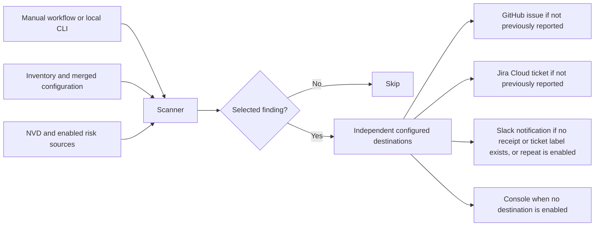

# infra-vuln-watch

[](https://github.com/iamunnip/infra-vuln-watch/actions/workflows/tests.yml)

CVE scan of infrastructure inventory.

This is an independent community project, unaffiliated with NIST, NVD, FIRST or CISA.
It retrieves and uses vulnerability data from the National Vulnerability Database (NVD)
through the NVD API. Version matching and generated findings are this project's own analysis.
This product uses the NVD API but is not endorsed or certified by the NVD.

When you start it, a GitHub Action checks each tool in `inventory/`, one scan at a time, against the
[National Vulnerability Database](https://nvd.nist.gov/) (NVD). When the installed version
is affected, it opens an issue in this repo:

```text
[LOW] [PROD] [2.1] CVE-2026-115363 openbao - OpenBao 2.2.0 before 2.6.4 ... contains an information disclosure...
```

The parts are `[SEVERITY] [ENVIRONMENT/deployment] [CVSS score] CVE-id Tool - summary`.
Environment labels are uppercase, with `production` displayed as `PROD`; a distinct deployment
ID follows when needed. Single-version
records omit the environment segment. Brackets are visual separators, not coloured badges.
The description holds the full details and the fix.

GitHub Issues is the default destination. You can also create **Jira Cloud tickets**, send
**Slack incoming webhook notifications**, or use console-only output. Configure these globally
in [`config.yaml`](config.yaml) and override them for individual inventory tools. See
[delivery setup](docs/diataxis/how-to/configure-delivery.md) and the
[complete configuration reference](docs/diataxis/reference/configuration.md).

The OpenBao inventory demonstrates production and staging with versions 2.5.5 and 2.6.4.
These are demo records, not real deployments or secure-version recommendations. Each deployment
can have its own version, team, owner and configuration; findings are tracked separately.
See the [inventory format](docs/diataxis/reference/inventory-format.md).

Each issue also shows:

- **Risk:** CVSS for severity, EPSS for the chance of an attack, and CISA KEV for known attacks.
- **A fix date:** based on severity, by default, from 2 days for critical to 21 days for low. Known exploited
  CVEs default to 2 days. [Configure deadlines globally, per tool or per deployment](docs/diataxis/reference/configuration.md).
- **Who is responsible:** the team and owner from the inventory.
- **Labels:** `severity-*`, `tool-*`, and `known-exploited` or `needs-review` when they apply.

Each later scan keeps open tickets current. It adds `known-exploited`, `overdue` or
`no-longer-affected` with a comment, updates a changed score in the title and tells Slack when enabled. It
never closes a ticket.
Jira tickets get the same formatted details as GitHub issues, ignored CVEs can have a reason and expiry
date, and output services that ask the scanner to slow down are respected.

See the [issue format](docs/diataxis/reference/issue-format.md) for the full details.

## Why not just ask NVD for my version?

NVD has an exact version lookup, but it depends on analyst data that many recent CVEs do not
have yet. On 2026-11-02, for OpenBao 2.5.5:

| Method | CVEs found |
| --- | --- |
| NVD exact version lookup | 0 |
| This tool | 16, including 1 critical and 2 high |

This tool runs two broader searches and compares versions itself, so it also catches CVEs that
NVD has not analysed. [ADR 0002](docs/adr/0002-search-nvd-twice-and-compare-versions-locally.md) has
the full reasoning.

## How it works



## Quick start

```bash
python -m venv .venv
.venv/bin/pip install -e ".[dev]"
.venv/bin/python -m infra_vuln_watch --dry-run
.venv/bin/python -m pytest
```

`--dry-run` previews selected destinations without creating issues, tickets, notifications or
local delivery receipts. It still reads enabled vulnerability data sources.

## Repo layout

| Path | What it holds |
| --- | --- |
| `inventory/` | One `.yaml` or `.yml` file per product, with versions and ownership per deployment |
| [`config.yaml`](config.yaml) | Global scan, source, delivery, notification and deadline settings |
| `src/infra_vuln_watch/` | Packages for CLI, application, configuration, domain, clients, persistence and reporting |
| `tests/` | Unit tests, run with `pytest` |
| `pyproject.toml` | Project settings and dependencies |
| `requirements.txt` | Hash-locked runtime packages installed by the scan workflow |
| [`SECURITY.md`](SECURITY.md) | How to report a bug in this tool privately |
| `.github/workflows/` | The scan, started by hand, and the tests |
| [`docs/`](docs/README.md) | Human documentation: Diataxis, C4 and ADRs |
| [`knowledge/`](knowledge/index.md) | Domain knowledge, as an OKF bundle |
| [`docs/c4/`](docs/c4/README.md) | Context, container, component, deployment and runtime views |
| [`docs/adr/`](docs/adr/README.md) | Architecture decision records |

## Documentation

Each standard answers a different question, so each kind of content has one clear home
([ADR 0018](docs/adr/0018-organise-documentation-under-docs.md),
[ADR 0036](docs/adr/0036-drop-arc42-and-keep-c4-diataxis-okf-and-adrs.md)).

| Question | Standard | Start here |
| --- | --- | --- |
| How do I use it? | Diataxis | [Your first scan](docs/diataxis/tutorials/first-scan.md) |
| How is it built? | C4 | [Architecture views](docs/c4/README.md) |
| Why was it built this way? | ADRs | [Decision list](docs/adr/README.md) |
| What should I know about the domain? | OKF | [Knowledge bundle](knowledge/index.md) |

## Data sources

- CVE records come from the [NVD API](https://nvd.nist.gov/developers), subject to its
  [terms of use](https://nvd.nist.gov/developers/terms-of-use).
- EPSS scores come from [FIRST's EPSS project](https://www.first.org/epss/).
  See FIRST's [usage and attribution guidance](https://www.first.org/epss/faq).
- Known exploited vulnerability data comes from the
  [CISA KEV catalog](https://www.cisa.gov/known-exploited-vulnerabilities-catalog).

NVD API access is subject to NVD's terms of use and published rate limits. The scanner spaces
requests and retries temporary failures, but access may still be rate limited or blocked.
The attribution notice does not guarantee continued API access or exempt users from those
terms. Avoid running multiple scans with a shared API key or outbound IP in a way that
exceeds the applicable limits.

Version matching, issue summaries and fix dates are generated by this project. They are not
official determinations or remediation deadlines issued by those organisations. CISA's own
due dates, when available, are shown separately in the issue details.

Third-party data, dependencies and referenced materials retain their respective rights and
applicable licenses or terms. The project's license does not relicense them. Names and
trademarks belong to their respective owners; their use identifies sources and products
and does not imply sponsorship or endorsement.

## License and disclaimer

The project's original code and documentation are provided under the [MIT License](LICENSE),
which permits use, modification and redistribution subject to retaining its copyright and
permission notice. No affiliation with or license to third-party trademarks is granted.
See [third-party notices](THIRD_PARTY_NOTICES.md) for dependency licenses and data attribution.

The scan workflow installs hash-locked packages from `requirements.txt`. Dependabot is configured to check Python and npm dependencies and GitHub Actions weekly once the
configuration is merged to the default branch. Dependency alerts and automatic security
updates also depend on the repository's GitHub security settings.

The software is provided **as is**, without warranty, as set out in the license. Vulnerability
data and matching results may be incomplete, delayed or incorrect. An empty scan does not
establish that a system is secure. Verify findings and upgrade guidance against vendor
advisories and your environment before acting. You are responsible for deployment and
remediation decisions.
