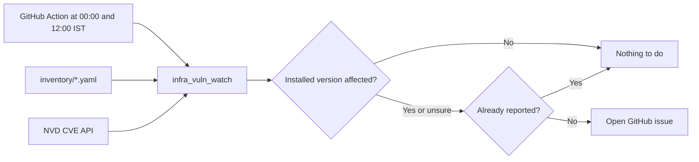

# infra-vuln-watch

[](https://github.com/iamunnip/infra-vuln-watch/actions/workflows/tests.yml)

Daily CVE scan of infrastructure inventory.

Twice a day, at 00:00 and 12:00 IST, a GitHub Action checks each tool in `inventory/` against the
[National Vulnerability Database](https://nvd.nist.gov/) (NVD). When the installed version
is affected, it opens an issue in this repo:

```text
[low][2.1][cve-2026-115363] - openbao: OpenBao 2.2.0 before 2.6.4 ... contains an information disclosure...
```

The parts are `[severity][cvss score][cve id] - name: summary`. The description holds the
full details and the fix.

## Why not just ask NVD for my version?

NVD has an exact version lookup, but it depends on analyst data that many recent CVEs do not
have yet. On 2026-11-02, for OpenBao 2.5.5:

| Method | CVEs found |
| --- | --- |
| NVD exact version lookup | 0 |
| This tool | 16, including 1 critical and 2 high |

This tool runs two broader searches and compares versions itself, so it also catches CVEs that
NVD has not analysed. [ADR 0002](adr/0002-search-nvd-twice-and-compare-versions-locally.md) has
the full reasoning.

## How it works



## Quick start

```bash
python -m venv .venv
.venv/bin/pip install -e ".[dev]"
.venv/bin/python -m infra_vuln_watch --dry-run
.venv/bin/python -m pytest
```

`--dry-run` prints what it finds and does not open issues.

## Repo layout

| Path | What it holds |
| --- | --- |
| `inventory/` | One YAML file per tool |
| `src/infra_vuln_watch/` | The Python package, one file per job |
| `tests/` | Unit tests, run with `pytest` |
| `pyproject.toml` | Project settings and dependencies |
| `.github/workflows/` | The daily schedule |
| [`docs/`](docs/README.md) | User docs, organised with Diataxis |
| [`knowledge/`](knowledge/index.md) | Domain knowledge, as an OKF bundle |
| [`arc42/`](arc42/README.md) | Architecture description |
| [`adr/`](adr/README.md) | Architecture decision records |

## Documentation

Each standard answers a different question, so each kind of content has one clear home
([ADR 0005](adr/0005-organise-docs-with-diataxis-okf-arc42-and-adr.md)).

| Question | Standard | Start here |
| --- | --- | --- |
| How do I use it? | Diataxis | [Your first scan](docs/tutorials/first-scan.md) |
| How is it built? | arc42 | [Architecture](arc42/README.md) |
| Why was it built this way? | ADRs | [Decision list](adr/README.md) |
| What should I know about the domain? | OKF | [Knowledge bundle](knowledge/index.md) |

## NVD notice

This product uses data from the NVD API but is not endorsed or certified by the NVD.
