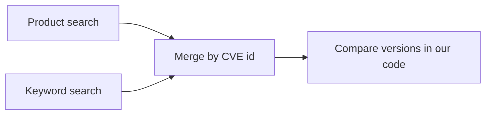

# 0002. Search NVD twice and compare versions locally

Date: 2026-11-02

Status: Accepted

## Context

NVD can filter by exact version with `cpeName`. We tested each search against live data for
OpenBao on 2026-11-02:

| Search | Results |
| --- | --- |
| `keywordSearch=openbao` | 44 CVEs |
| `virtualMatchString=cpe:2.3:a:openbao:openbao` | 25 CVEs, including 5 the keyword search missed |
| `cpeName` for 2.5.0 | 7 CVEs |
| `cpeName` for 2.7.2 | 0 CVEs |

`cpeName` relies on analyst data, and many recent CVEs have the status `Deferred` or
`Awaiting Analysis` with no such data. Relying on it would miss real vulnerabilities.

## Decision

Run both the product search and the keyword search, merge by CVE id, and compare versions in
our own code using both `configurations` and `affected` data.

## Consequences

- New CVEs are found before NVD analyses them.
- We own the version parsing code, which needs tests.
- Each tool needs two API calls, so a scan is slower without a key.
- Vendor and product must be checked locally, because keywords also match other products.
