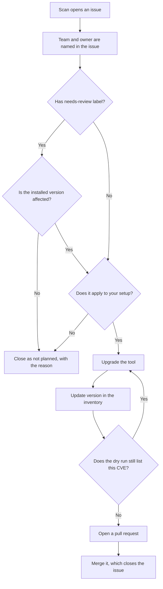
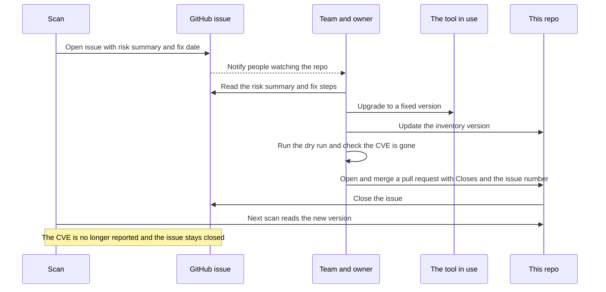
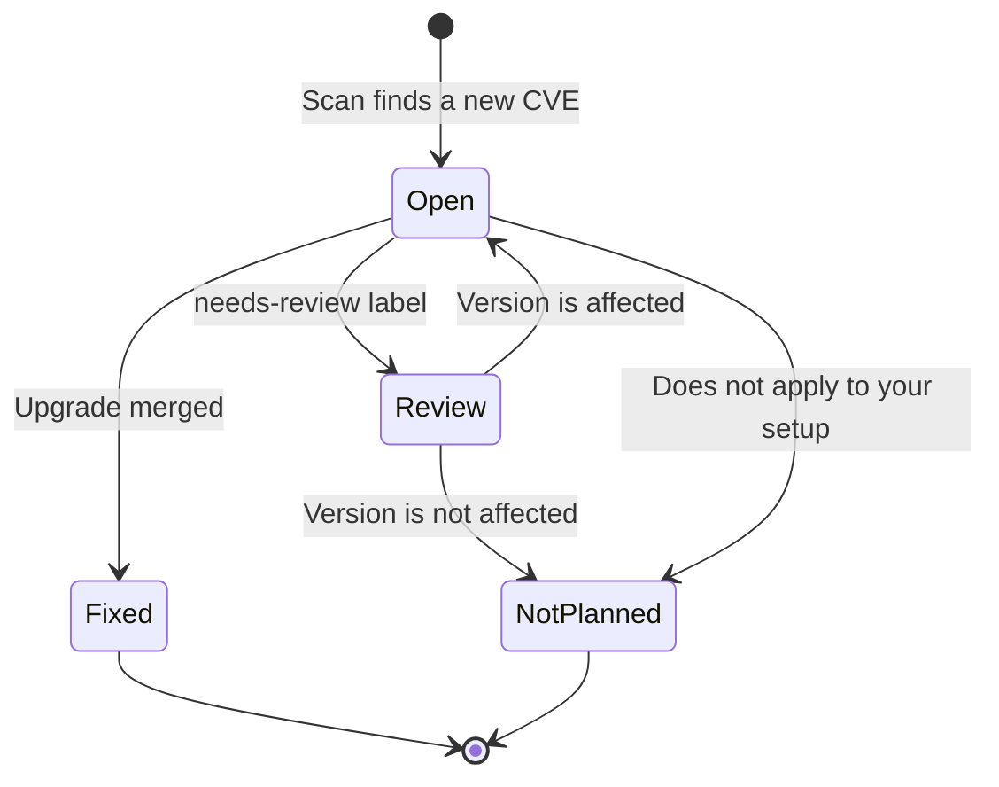

# 0013. How a vulnerability gets fixed

Date: 2026-11-02

Status: Accepted

## Context

The tool finds CVEs and opens issues, but people do the fixing. Without one agreed process, an
issue could be closed without a real upgrade, or an upgrade could happen while the issue and the
inventory stay out of date. The inventory is what the scan trusts, so it has to match what runs.

## Decision

A person fixes each vulnerability by upgrading the tool, and the change to the inventory goes
through a pull request. The tool never upgrades anything, and never closes or reopens an issue.

### The path of a vulnerability

### Who does what

### States of an issue

### The steps

1. Handle issues in this order: listed on CISA KEV first, which always have a 2 day deadline, then high CVSS with high EPSS, then the
   rest by fix date.
2. Upgrade the tool to the fixed version or later. Prefer the latest release, because a newer
   release branch can be affected too.
3. Update `version` in the inventory file.
4. Run `python -m infra_vuln_watch --dry-run` and check that the CVE is gone.
5. Open a pull request with one `Closes #number` line for each issue it fixes.
6. If the issue does not apply, close it as not planned and say why in a comment.

## Consequences

- Each fix leaves a record: the pull request links the issue to the version change.
- The inventory stays true, because the upgrade and the version change happen together.
- One upgrade usually fixes many CVEs, so one pull request can close many issues.
- Closing is manual. An issue left open after an upgrade stays open, so check the dry run and close
  the others it fixes.
- A closed issue never comes back. If someone closes one by mistake, or the tool is later
  downgraded, reopen the issue by hand.
- Nothing checks that the real deployment matches the inventory, or warns when a fix date passes.
