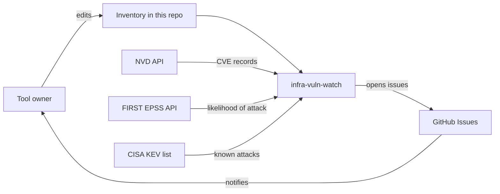
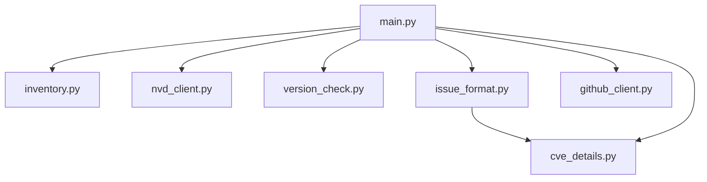
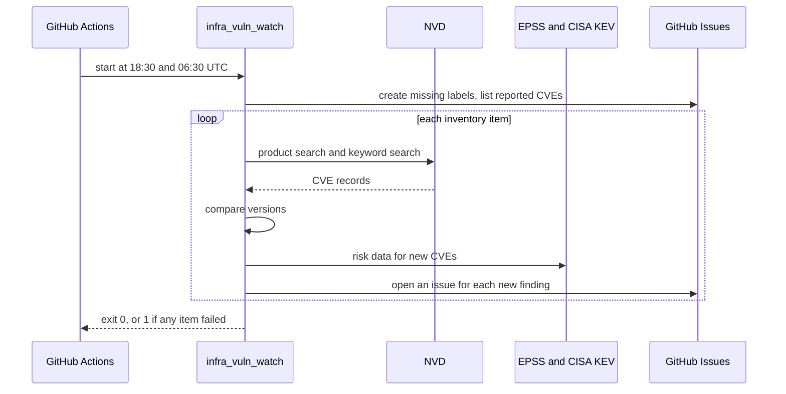
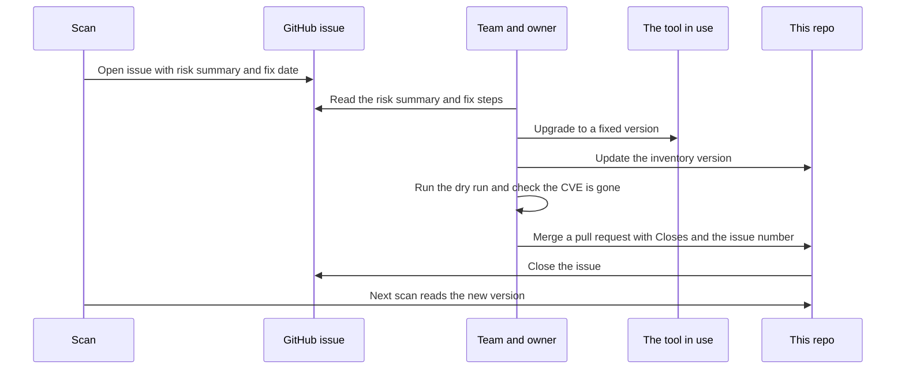
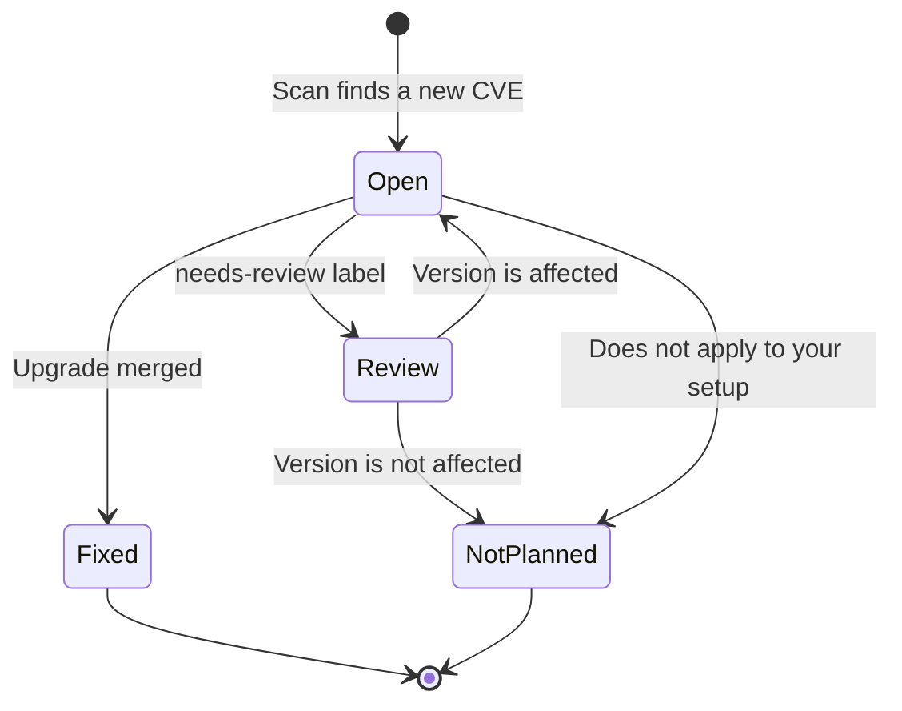

# Architecture of infra-vuln-watch

This description follows the [arc42](https://arc42.org/) template.

## 1. Introduction and goals

infra-vuln-watch tells the owners of infrastructure tools when a known CVE affects the version
they run.

| Priority | Quality goal | What it means here |
| --- | --- | --- |
| 1 | Reliability of results | A broken scan must never look like "no CVEs found" |
| 2 | Low noise | One issue per tool and CVE, never repeated |
| 3 | Simplicity | Beginner friendly Python that anyone on the team can change |

Stakeholders: tool owners read issues, and maintainers edit the inventory and code.

## 2. Constraints

- Runs on GitHub Actions with no server and no database.
- Python, with few libraries.
- NVD rate limits: 5 requests per 30 seconds, or 50 with a key.
- Must show the NVD attribution notice.

## 3. Context and scope

Out of scope: fixing vulnerabilities, scanning running systems, and scanning libraries inside
a tool.

## 4. Solution strategy

- Use scheduled runs with no stored state. GitHub Issues remember what was reported
  ([ADR 0004](../adr/0004-use-github-issues-as-state.md)).
- Search NVD twice and compare versions locally
  ([ADR 0002](../adr/0002-search-nvd-twice-and-compare-versions-locally.md)).
- When unsure, report and ask a human ([ADR 0003](../adr/0003-report-unknown-results.md)).
- People do the fixing, through a pull request ([ADR 0013](../adr/0013-how-a-vulnerability-gets-fixed.md)).

## 5. Building block view

The package lives in `src/infra_vuln_watch/`, with tests in `tests/`. See
[ADR 0006](../adr/0006-use-the-python-src-layout.md).

| File | Job |
| --- | --- |
| `__main__.py` | Lets the tool run with `python -m infra_vuln_watch` |
| `main.py` | Runs the steps in order and sets the exit code |
| `inventory.py` | Reads and checks the YAML files |
| `nvd_client.py` | Downloads CVEs, with paging, waiting and retries |
| `version_check.py` | Decides affected, not affected or unknown, and finds the fix |
| `cve_details.py` | Pulls the score, description and links out of a CVE |
| `risk_data.py` | Downloads EPSS scores and the CISA KEV list |
| `fix_deadline.py` | Works out the fix date from the severity |
| `issue_format.py` | Writes the issue title and body, and cleans NVD text |
| `github_client.py` | Creates labels and issues, and lists what is already reported |

## 6. Runtime view

### Fixing a vulnerability

The scan stops at opening the issue, and people do the rest
([ADR 0013](../adr/0013-how-a-vulnerability-gets-fixed.md)).

### Life of an issue

## 7. Deployment view

`.github/workflows/tests.yml` runs the tests on each push and pull request.

`.github/workflows/daily-scan.yml` runs the scan on a GitHub hosted runner. The cron is
`30 6,18 * * *`, which is 00:00 and 12:00 IST. See [ADR 0007](../adr/0007-scan-twice-a-day.md). Settings are `GITHUB_TOKEN`, provided by Actions, and
`NVD_API_KEY`, an optional secret.

## 8. Crosscutting concepts

- **Untrusted input:** CVE text can be written by anyone. It is cleaned before it reaches an
  issue, so it cannot mention users or fake the marker.
- **Duplicate protection:** each issue holds a hidden `vuln-watch-id`. Only issues with the
  `vuln-watch` label are trusted, because strangers cannot add labels in a public repo.
- **Least privilege:** the workflow token can only read code and write issues. Actions are
  pinned to commit SHAs.
- **Human remediation:** people upgrade tools and close issues, and the scan never does either.
  The inventory only changes through a pull request, so each fix leaves a record.
- **Failure handling:** a failed tool does not stop the others, but it does fail the run.

## 9. Architecture decisions

See the [ADR list](../adr/README.md).

## 10. Quality requirements

| Scenario | Expected result |
| --- | --- |
| NVD is down during a run | Retries, then the run fails and shows red |
| The scan runs twice in a day | No duplicate issues |
| An owner closes an issue | It is not reopened |
| An upgrade is merged | The next scan stops reporting the fixed CVEs |
| A CVE has no version data | An issue with `needs-review` is opened |
| A CVE description contains `@someone` | Nobody is notified |
| EPSS or CISA KEV is down | The issue still opens and says `Could not check` |
| A CVE scores 0.0 | No issue is opened |

## 11. Risks and technical debt

| Risk | Impact | Response |
| --- | --- | --- |
| NVD data arrives late or incomplete | Late alerts | Keyword search and unknown results reduce this. A second source can be added later |
| Inventory version goes stale | Wrong results | The fix process updates it with each upgrade. Automatic detection is not built |
| A fix date passes unnoticed | Late fixes | Accepted for now. An `overdue` label could be added later |
| GitHub disables idle schedules after 60 days | Scans silently stop | GitHub sends an email warning, and the owner re-enables the workflow |
| A CVE joins the KEV list after its issue opened | Urgency is missed | Accepted for now. The issue says its risk results can change |
| Wrong vendor or product name in the inventory | Missed CVEs | The how-to guide shows how to look up names |
| A scored issue is not updated if NVD changes the score | Stale title | Accepted for simplicity. The NVD link shows the current score |

## 12. Glossary

| Term | Meaning |
| --- | --- |
| CVE | A public identifier for one known vulnerability |
| CVSS | A 0 to 10 scoring system for severity |
| EPSS | The estimated chance of a CVE being exploited in the next 30 days |
| KEV | The CISA list of vulnerabilities known to have been exploited |
| CPE | A standard name for a product and version |
| CWE | A category of weakness, like "missing authorization" |
| NVD | The US National Vulnerability Database |
