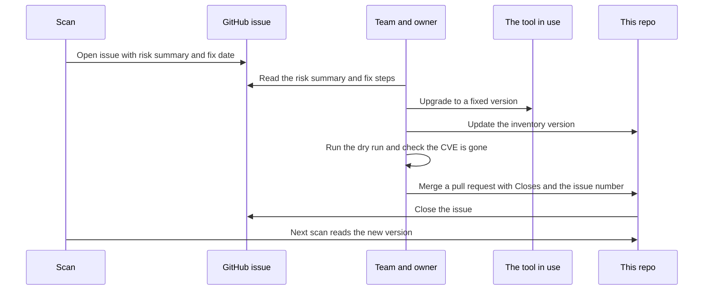
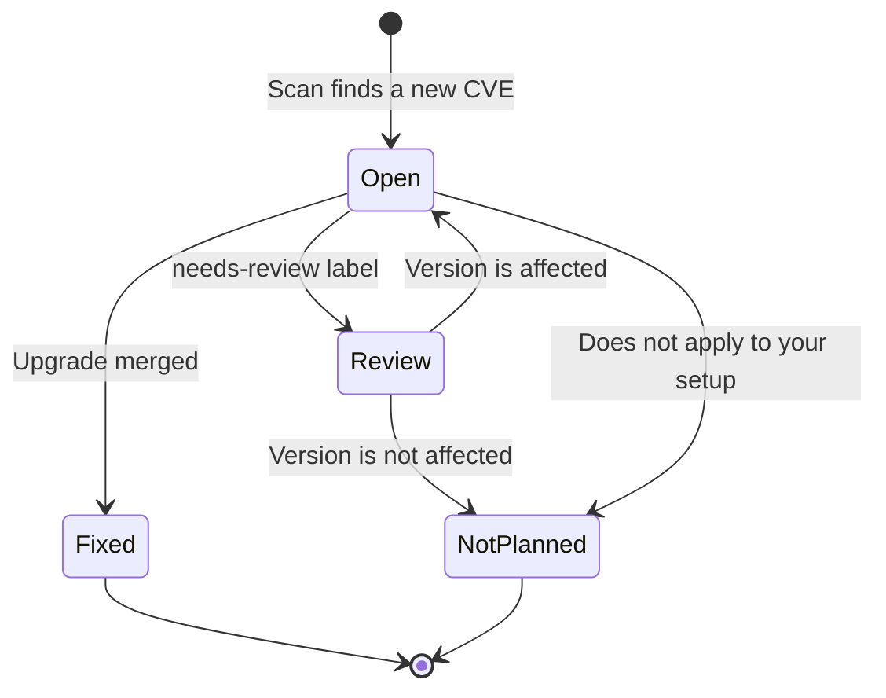

# 6. Runtime view

### Scan and reporting

```mermaid
sequenceDiagram
    actor U as Maintainer
    participant A as Actions or local CLI
    participant M as Scanner
    participant N as NVD
    participant R as EPSS and KEV
    participant T as Enabled GitHub and Jira trackers
    participant S as Slack webhook
    participant F as Local receipts
    U->>A: Start scan
    A->>M: Start CLI with config and inventory
    M->>M: Expand deployments; merge global, tool and deployment settings; skip disabled targets
    opt Enabled non-preview destinations
        M->>T: Initialise labels and load each destination's history
        M->>F: Load Slack receipts if enabled and not repeating
    end
    loop Each enabled deployment or legacy inventory item
        opt KEV source enabled and not already cached for these settings
            M->>R: Download catalog
        end
        opt Candidate records not already cached for this product and source settings
            M->>N: Run enabled product and/or keyword searches, all pages
        end
        N-->>M: Candidate CVE records
        M->>M: Filter and compare installed versions
        opt EPSS enabled and pending deliveries exist
            M->>R: Fetch scores for pending findings
        end
        loop Each selected finding
            alt CLI or tool dry run
                M->>M: Print destination preview without output calls or receipt writes
            else Normal delivery
                M->>T: Create only missing tickets, independently
                opt Slack enabled and receipt absent, or repeat enabled
                    M->>S: Send plain-text notification
                    S-->>M: Delivery acknowledgement
                    M->>F: Atomically save successful receipt unless repeating
                end
            end
        end
        opt Normal delivery and update_existing on
            M->>T: Comment on and relabel this target's open tickets whose facts changed
        end
    end
    M-->>A: Exit 1 on source, setup or delivery failure; otherwise 0
```

Invalid configuration or inventory, missing required credentials, corrupt Slack state or an
unreadable tracker history fails before CVE scanning. During scanning, source failures and
invalid CVE data fail that tool but later tools are still checked. Failed deliveries do not
prevent attempts to other destinations or findings; any failure makes the final exit code 1. A malformed
CVE record fails only itself, so other findings for that tool are still delivered. A destination that keeps
rate limiting the scanner gets no more requests during the run, and the others continue.

KEV is cached per distinct source configuration. EPSS and KEV outages are warnings and do not
prevent delivery. Disabled sources are identified separately in finding details. Optional
NVD KEV fallback can identify exploitation without a catalog download.

Preview mode skips every output API and receipt write, while retaining enabled vulnerability
source reads. Each tracker independently suppresses previously reported `tool/CVE` markers for legacy records and `tool/deployment-id/CVE` markers for deployments,
including closed tickets. Existing tickets are not refreshed or reopened. Slack receipts
provide independent deduplication and allow notification retries after successful ticket
creation. Remote writes are not automatically retried; ambiguous timeouts and lost receipts
can cause duplicates on a later run.

### Fixing a vulnerability

The scan stops at opening the issue, and people do the rest
([ADR 0013](../adr/0013-how-a-vulnerability-gets-fixed.md)).



### Life of an issue



[Architecture index](README.md)

Different deployments are evaluated independently, including ownership and fix deadlines. A
production finding cannot be suppressed by staging's ticket or notification receipt. IDs remain
stable across version changes. Legacy unscoped history is retained but is not automatically
mapped to a newly introduced deployment.
