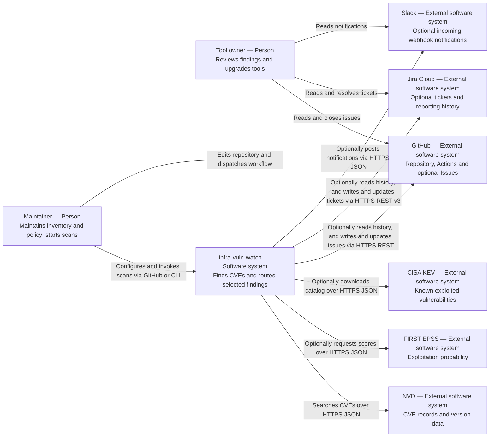

# System context (C4 level 1)

Scope: infra-vuln-watch and the people and external systems it interacts with.

See [the arc42 explanation](../arc42/03-context-and-scope.md) and the [view index](README.md).
