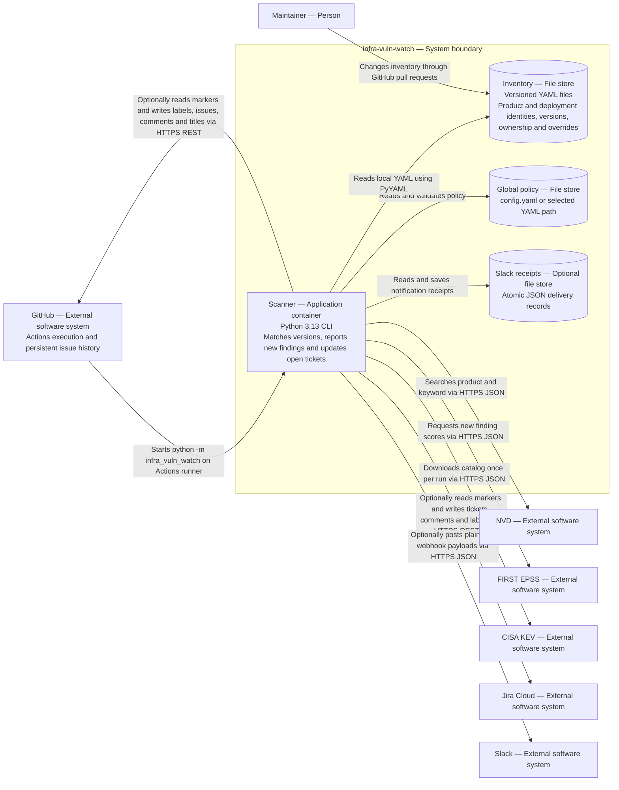

# Containers (C4 level 2)

Scope: the infra-vuln-watch system. The CLI is an application container and inventory is a file store. GitHub provides execution and issue persistence externally.

See [the arc42 explanation](../arc42/05-building-block-view.md) and the [view index](README.md).
