# Components (C4 level 3)

Scope: the Scanner application container. Internal relationships are in-process calls.
External APIs use HTTPS JSON.

```mermaid
flowchart TD
    files[("Inventory YAML: File store")]
    settings[("Global config.yaml: File store")]
    receipts[("Slack receipts: Optional local file store")]
    nvdapi["NVD: External system"]
    riskapi["FIRST EPSS and CISA KEV: External systems"]
    ghapi["GitHub Issues: External system"]
    jiraapi["Jira Cloud: External system"]
    slackapi["Slack: External system"]
    subgraph scanner["Scanner: Python application container"]
        entry["__main__.py: Entry point<br/>Invokes CLI and propagates exit code"]
        cli["cli/main.py: CLI<br/>Parses options; prepares validated tool settings"]
        config["configuration/config.py: Configuration<br/>Validates and merges global and tool settings"]
        main["application/scanner.py: Orchestration<br/>Filters and enriches findings; isolates failures"]
        inventory["configuration/inventory.py: Inventory loader<br/>Normalises tool metadata, validates YAML and expands deployments"]
        nvd["clients/nvd_client.py: CVE retrieval<br/>Configured searches, paging and retries; reused per scan"]
        identity["domain/identity.py: Finding identity<br/>Stable tool/deployment keys and scoped names"]
        check["domain/version_check.py: Version matching<br/>Affected, not affected or unknown; fix guidance"]
        risk["clients/risk_data.py: Risk enrichment<br/>Optional EPSS and KEV; NVD fallback"]
        router["application/router.py: Output routing<br/>Independent destination history and delivery"]
        format["reporting/issue_format.py: Presentation<br/>Sanitised titles, bodies and identity markers"]
        details["domain/cve_details.py: CVE interpretation<br/>Scores, summaries and references"]
        deadline["domain/fix_deadline.py: Fix policy<br/>Severity and KEV based due dates"]
        updates["application/ticket_updates.py: Ticket updates<br/>Plans labels, comments and titles for open tickets"]
        ignores["domain/ignore_list.py: Ignore policy<br/>Reasons and expiry dates"]
        limits["clients/rate_limit.py: Rate limits<br/>Waits once, then marks a destination as limited"]
        jiraformat["reporting/jira_format.py: Jira presentation<br/>Converts findings to ADF without active nodes"]
        github["clients/github_client.py: GitHub persistence<br/>Labels, history, new issues and updates"]
        jira["clients/jira_client.py: Jira Cloud persistence<br/>JQL history, ADF tickets and updates"]
        slack["clients/slack_client.py: Notifications<br/>Plain-text webhook payloads and receipts"]
        state["persistence/state.py: Local persistence<br/>Atomic Slack delivery receipts"]
        entry -->|Invokes| cli
        cli -->|Loads and merges settings| config
        cli -->|Loads tools| inventory
        cli -->|Runs scan with resolved settings| main
        inventory -->|Validates tool overrides| config
        main -->|Fetches candidate CVEs| nvd
        main -->|Checks installed version| check
        main -->|Applies severity filter| details
        main -->|Fetches enabled enrichment| risk
        main -->|Prepares outputs and reports findings| router
        main -->|Identifies scan targets| identity
        inventory -->|Checks target uniqueness| identity
        router -->|Keys routes and findings| identity
        format -->|Scopes names and markers| identity
        router -->|Builds titles and bodies| format
        router -->|Selects labels| details
        router -->|Reads history, creates and updates issues| github
        router -->|Reads history, creates and updates tickets| jira
        router -->|Plans open ticket changes| updates
        router -->|Labels tickets with Slack delivery| github
        router -->|Sends ticket update messages| slack
        main -->|Applies ignores| ignores
        router -->|Skips ignored tickets| ignores
        github -->|Sends through| limits
        jira -->|Sends through| limits
        slack -->|Sends through| limits
        jira -->|Formats descriptions| jiraformat
        router -->|Delivers pending notifications| slack
        router -->|Shares receipt state by file path| state
        slack -->|Reads and saves receipts| state
        format -->|Extracts CVE details| details
        format -->|Calculates due date with tool policy| deadline
        deadline -->|Resolves policy defaults| config
    end
    inventory -->|Reads YAML| files
    config -->|Reads global YAML| settings
    state -->|Atomically replaces JSON file| receipts
    nvd -->|Searches CVE API| nvdapi
    risk -->|Fetches enabled data| riskapi
    github -->|Reads and writes REST resources| ghapi
    jira -->|Searches and creates via REST v3| jiraapi
    slack -->|Posts incoming webhook| slackapi
```



## Modules

The package lives in `src/infra_vuln_watch/`, with tests in `tests/`. See
[ADR 0006](../adr/0006-use-the-python-src-layout.md).

| File | Job |
| --- | --- |
| `__main__.py` | Lets the tool run with `python -m infra_vuln_watch` |
| `cli/main.py` | Parses CLI options, loads global configuration, validates and resolves tool policy |
| `application/scanner.py` | Applies scan filters, enriches findings, routes delivery and returns the exit code |
| `configuration/config.py` | Validates and recursively merges defaults, global settings and tool overrides |
| `persistence/state.py` | Atomically persists successful Slack notification receipts |
| `application/router.py` | Routes each finding independently to configured trackers and Slack, and applies ticket updates |
| `application/ticket_updates.py` | Decides which labels, comments and title an open ticket needs |
| `clients/rate_limit.py` | Waits once when an output service asks, then marks it as limited |
| `domain/ignore_list.py` | Reads ignore entries, with their reasons and expiry dates |
| `reporting/jira_format.py` | Converts a finding's Markdown into Atlassian Document Format |
| `clients/jira_client.py` | Reads Jira Cloud reporting history, and creates and updates tickets using REST v3 |
| `clients/slack_client.py` | Sends plain-text Slack webhook payloads and records delivery |
| `configuration/inventory.py` | Normalises grouped tool metadata, validates files and expands deployment-specific targets |
| `domain/identity.py` | Defines stable scan target IDs, finding IDs, the shared ticket marker and scoped display names |
| `clients/nvd_client.py` | Downloads CVEs, with paging, waiting and retries |
| `domain/version_check.py` | Decides affected, not affected or unknown using names, aliases and reporter statuses, and finds the fix |
| `domain/cve_details.py` | Pulls the score, description and links out of a CVE |
| `clients/risk_data.py` | Downloads EPSS scores and the CISA KEV list; `domain/cve_details.py` reads a CVE's KEV entry |
| `domain/fix_deadline.py` | Works out the fix date from the severity |
| `reporting/issue_format.py` | Writes the issue title and body, and cleans NVD text |
| `clients/github_client.py` | Creates labels and issues, updates open issues, and lists what is already reported |

## Package layout

```text
src/infra_vuln_watch/
├── __init__.py
├── __main__.py
├── application/
│   ├── __init__.py
│   ├── router.py
│   ├── scanner.py
│   └── ticket_updates.py
├── cli/
│   ├── __init__.py
│   └── main.py
├── clients/
│   ├── __init__.py
│   ├── github_client.py
│   ├── jira_client.py
│   ├── nvd_client.py
│   ├── rate_limit.py
│   ├── risk_data.py
│   └── slack_client.py
├── configuration/
│   ├── __init__.py
│   ├── config.py
│   └── inventory.py
├── domain/
│   ├── __init__.py
│   ├── cve_details.py
│   ├── fix_deadline.py
│   ├── identity.py
│   ├── ignore_list.py
│   └── version_check.py
├── persistence/
│   ├── __init__.py
│   └── state.py
└── reporting/
    ├── __init__.py
    ├── issue_format.py
    └── jira_format.py
```

| Package | Responsibility |
| --- | --- |
| `cli/` | Argument parsing and the installed command entry point |
| `application/` | Scan orchestration and delivery routing |
| `configuration/` | Global settings, inventory validation and override resolution |
| `domain/` | Stable finding identities, CVE interpretation, version matching and deadline policy |
| `clients/` | External HTTP integrations |
| `persistence/` | Atomic local delivery state |
| `reporting/` | Finding presentation and sanitisation |

Only package initialisation and `__main__.py` remain at the package root. Domain CVE details
are shared by scanning and presentation; the output router belongs with application orchestration.
The installed CLI uses `infra_vuln_watch.cli.main:main`; `python -m infra_vuln_watch` delegates
to the same function. Reinstall an existing editable installation after entry-point changes:

```bash
.venv/bin/pip install -e ".[dev]"
```

Internal import paths changed; CLI options, configuration and finding behaviour are unchanged.
See [ADR 0020](../adr/0020-group-source-by-responsibility.md), extending
[ADR 0019](../adr/0019-layer-source-and-configure-scans-and-delivery.md).

Inventory expansion produces one scan target per deployment before global settings are resolved.
Tool and deployment override mappings merge without injecting defaults, preserving the precedence
of built-in, global, tool and deployment layers. Each target has its own version and ownership.
NVD candidates are cached in memory by vendor, product, keyword and source settings, then
matched separately. Route keys, tracker markers and Slack receipts use the shared identity
helpers, so different deployments of one product cannot overwrite each other's routes.
See [ADR 0021](../adr/0021-track-deployments-independently.md).

The recommended inventory groups product metadata under `tool`, alongside `config` and
`deployments`. Normalisation preserves the existing internal target shape and finding IDs;
legacy flat documents remain supported. See [ADR 0022](../adr/0022-group-inventory-product-metadata.md).

[View index](README.md)
