# Components (C4 level 3)

Scope: the Scanner application container. Internal relationships are in-process calls.
External APIs use HTTPS JSON.

```mermaid
flowchart TD
    files[("Inventory YAML — File store")]
    settings[("Global config.yaml — File store")]
    receipts[("Slack receipts — Optional local file store")]
    nvdapi["NVD — External system"]
    riskapi["FIRST EPSS and CISA KEV — External systems"]
    ghapi["GitHub Issues — External system"]
    jiraapi["Jira Cloud — External system"]
    slackapi["Slack — External system"]
    subgraph scanner["Scanner — Python application container"]
        entry["__main__.py — Entry point<br/>Invokes CLI and propagates exit code"]
        cli["cli/main.py — CLI<br/>Parses options; prepares validated tool settings"]
        config["configuration/config.py — Configuration<br/>Validates and merges global and tool settings"]
        main["application/scanner.py — Orchestration<br/>Filters and enriches findings; isolates failures"]
        inventory["configuration/inventory.py — Inventory loader<br/>Validates YAML and expands deployment targets"]
        nvd["clients/nvd_client.py — CVE retrieval<br/>Configured searches, paging and retries; reused per scan"]
        identity["domain/identity.py — Finding identity<br/>Stable tool/deployment keys and scoped names"]
        check["domain/version_check.py — Version matching<br/>Affected, not affected or unknown; fix guidance"]
        risk["clients/risk_data.py — Risk enrichment<br/>Optional EPSS and KEV; NVD fallback"]
        router["application/router.py — Output routing<br/>Independent destination history and delivery"]
        format["reporting/issue_format.py — Presentation<br/>Sanitised titles, bodies and identity markers"]
        details["domain/cve_details.py — CVE interpretation<br/>Scores, summaries and references"]
        deadline["domain/fix_deadline.py — Fix policy<br/>Severity and KEV based due dates"]
        github["clients/github_client.py — GitHub persistence<br/>Labels, history and new issues"]
        jira["clients/jira_client.py — Jira Cloud persistence<br/>JQL history and ADF ticket descriptions"]
        slack["clients/slack_client.py — Notifications<br/>Plain-text webhook payloads and receipts"]
        state["persistence/state.py — Local persistence<br/>Atomic Slack delivery receipts"]
        entry -->|Invokes| cli
        cli -->|Loads and merges settings| config
        cli -->|Loads tools| inventory
        cli -->|Runs scan with resolved settings| main
        inventory -->|Validates tool overrides| config
        main -->|Fetches candidate CVEs| nvd
        main -->|Checks installed version| check
        main -->|Applies severity filter| details
        main -->|Fetches enabled enrichment| risk
        main -->|Prepares outputs and reports findings| router
        main -->|Identifies scan targets| identity
        inventory -->|Checks target uniqueness| identity
        router -->|Keys routes and findings| identity
        format -->|Scopes names and markers| identity
        router -->|Builds titles and bodies| format
        router -->|Selects labels| details
        router -->|Checks known exploitation| risk
        router -->|Reads history and creates issues| github
        router -->|Reads history and creates tickets| jira
        router -->|Delivers pending notifications| slack
        router -->|Shares receipt state by file path| state
        slack -->|Reads and saves receipts| state
        format -->|Extracts CVE details| details
        format -->|Resolves risk presentation| risk
        format -->|Calculates due date with tool policy| deadline
        deadline -->|Resolves policy defaults| config
    end
    inventory -->|Reads YAML| files
    config -->|Reads global YAML| settings
    state -->|Atomically replaces JSON file| receipts
    nvd -->|Searches CVE API| nvdapi
    risk -->|Fetches enabled data| riskapi
    github -->|Reads and writes REST resources| ghapi
    jira -->|Searches and creates via REST v3| jiraapi
    slack -->|Posts incoming webhook| slackapi
```

See [the arc42 explanation](../arc42/05-building-block-view.md) and the [view index](README.md).
