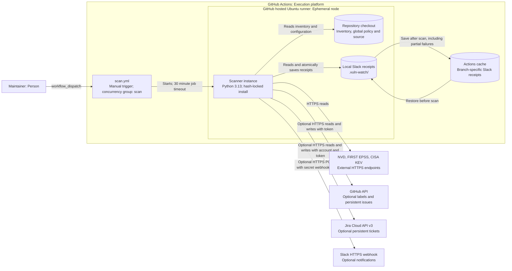

# Deployment

Scope: the manual GitHub Actions scan on an ephemeral hosted runner.

`.github/workflows/tests.yml` runs lint, type checks, tests with coverage and the documentation check when a
pull request is opened or updated. It does not run on a merge. Branch protection on `main` requires its `test` check,
for administrators too, so a pull request cannot merge until the check passes.

`.github/workflows/scan.yml` runs the scan on a GitHub hosted runner when someone starts it, one
scan at a time.
Actions provides `GITHUB_TOKEN` and `GITHUB_REPOSITORY`; `NVD_API_KEY` is an optional secret.
The token has `contents: read` and `issues: write`. Runner files disappear after the job;
repository history and issues remain on GitHub. A local installation can run the CLI too;
normal delivery requires credentials only for enabled destinations. Jira uses `JIRA_EMAIL`
and `JIRA_API_TOKEN`; Slack uses `SLACK_WEBHOOK_URL`, mapped from Actions secrets by default.
`--dry-run` requires no output credentials. The default `.vuln-watch/` Slack receipt directory
is restored and saved using a branch-specific Actions cache, including on failed scans.
Caches are best effort and may be evicted. Custom receipt paths require corresponding workflow
cache changes. External tickets persist in their respective services.
GitHub evicts a cache left unused for 7 days, so manual scans further apart than that can lose
receipts. Tickets also record delivery, so this repeats notifications only for Slack without a tracker
([ADR 0032](../adr/0032-record-slack-delivery-on-tickets.md)).
The scan installs hash-locked packages from `requirements.txt` and downloads nothing else
([ADR 0027](../adr/0027-lock-scan-dependencies-and-add-quality-checks.md)).
Workflow concurrency serialises Actions scans; it does not lock independent local executions.

The Slack receipt cache restore and save steps are both pinned to `actions/cache` v6.1.0's
commit. They use the Node 24 action runtime on the hosted Ubuntu runner. Self-hosted runners
would need version 2.327.1 or newer, per the
[upstream runtime requirements](https://github.com/actions/cache/tree/55cc8345863c7cc4c66a329aec7e433d2d1c52a9#whats-new).
Dependabot groups the cache action family for version updates and, separately, security updates.

[View index](README.md)
