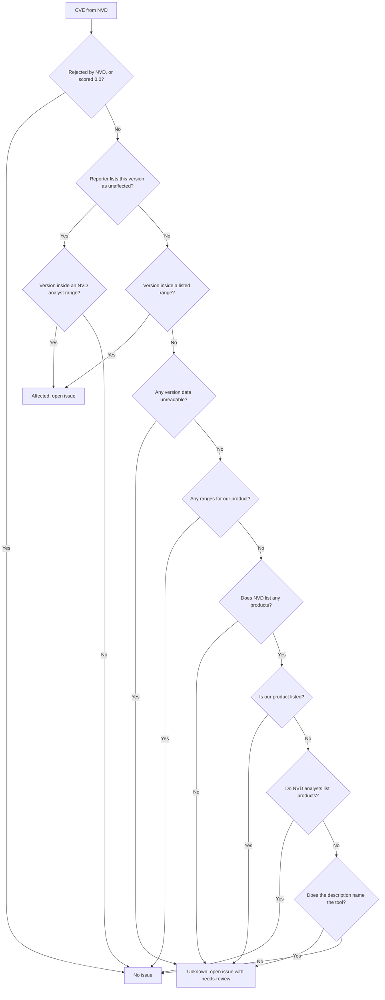

# How matching works

The hard part of this tool is not downloading CVEs. It is deciding which ones apply to the
version you run, because NVD data is often incomplete.

## Why two searches

NVD analysts add product data (called CPE data) to CVEs, but many recent CVEs are still waiting
or are deferred. Searching only by product misses them. Searching only by keyword misses CVEs
whose text never names the product. For OpenBao in November 2026, each search found CVEs the
other missed, so the tool runs both and merges the results.

## Why there are no date filters

NVD recommends date filters for fetching only what changed, which suits systems that keep their own
copy of NVD. This tool keeps no copy and asks about one product at a time. A date filter would hide
older CVEs from a newly added tool or a changed version.
[ADR 0014](../../adr/0014-keep-full-product-searches.md) has the numbers.

## Why versions are compared locally

NVD can filter by exact version, but that returned nothing for a new release that was not yet
in its product dictionary, and it skips CVEs without analyst data. So the tool downloads every
CVE for the product and compares versions itself.

## Three possible answers

| Answer | When | Result |
| --- | --- | --- |
| Affected | The version is inside a listed range | Issue |
| Not affected | Ranges exist and the version is outside them, the reporter lists it as unaffected, or the CVE is about another product | No issue |
| Unknown | The data is missing or cannot be read, or the reporter names another product but the description names this tool | Issue with `needs-review` |

Reporters spell names freely, so one product can be `apache` and `http_server` in NVD analyst data
but `Apache Software Foundation` and `Apache HTTP Server` in reporter data. A miss on reporter names
alone is therefore not proof that a CVE is about something else. Add the other spelling as a
[tool alias](../reference/inventory-format.md#product-fields) to get an exact answer.
[ADR 0025](../../adr/0025-widen-reporter-name-and-status-matching.md) has the reasoning.

Severity filters run before version matching. They never apply to known exploited CVEs
([ADR 0026](../../adr/0026-known-exploited-cves-pass-severity-filters.md)).

A CVE that NVD rejected, or that has a CVSS score of 0.0, never gets an issue. A CVE with no score
at all still does, because no score does not mean no risk.

Unknown opens an issue on purpose. A false alarm costs a minute of someone's time, while a
hidden vulnerability can cost far more.

## Severity, likelihood and urgency

Matching decides whether a CVE gets an issue. CVSS, EPSS and CISA KEV then help you decide what to
fix first, and they answer different questions. A CVE can have a high CVSS score and almost no
chance of attack, so a high score alone does not make it the most urgent. If EPSS or KEV is down the
issue still opens, because knowing about a CVE matters more than having every detail.

## Why deadlines start when the issue opens

Each severity has a fix window. The clock starts when the issue opens and not when the CVE was
published, because some CVEs are published long before they are found here. Counting from
publication would make them overdue before anyone had seen them.

## Why only one scan runs at a time

Each scan reads the list of reported CVEs once, when it starts. Two scans running together would not
see each other's new issues, so both could open the same one. The workflow makes the second scan
wait, so it reads the list after the first has finished.

## Limits

- The tool knows versions, not how you use the tool. An affected version may not be exploitable
  in your setup.
- A CVE that NVD has not published will not be matched. Nor will one that names a different vendor
  or product than your inventory file and aliases, unless its description names the tool, which
  opens a review issue instead.
- It does not check the libraries inside a tool.
- Open issues are only brought up to date when a scan runs, so a CVE added to the KEV list later is
  flagged at the next scan, not when it is listed.

See also [ADR 0002](../../adr/0002-search-nvd-twice-and-compare-versions-locally.md) and
[ADR 0003](../../adr/0003-report-unknown-results.md).
