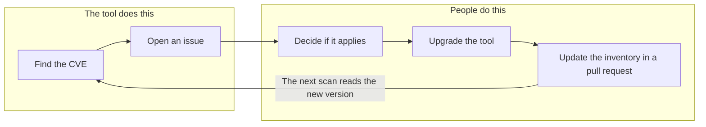

# Why people do the fixing

The tool could try to do more, such as closing issues by itself or upgrading tools. It stops at
reporting on purpose, for the reasons below. [ADR 0013](../../adr/0013-how-a-vulnerability-gets-fixed.md)
records the decision.

## An upgrade needs judgement

A new version can bring breaking changes, and the right moment depends on your setup. A CVE can also
be irrelevant to you. For example, a bug in a feature you have turned off may not need an urgent
fix. A person can weigh that, and the tool only knows version numbers.

## The inventory is a claim, not a measurement

The tool believes what the inventory says. It never looks at the real system. If it updated the
version by itself, the inventory could say a fix happened when it did not. Asking a person to change
the version after the upgrade keeps the claim honest, and the pull request records who made it.

## Why issues do not close by themselves

Closing an issue as soon as the inventory changes would be possible, but a closed issue means a
person has finished the work. "Not planned" also records a real decision, so the tool treats any
closed issue as final and does not reopen it. When the inventory no longer matches a CVE, the scan adds a
`no-longer-affected` label and a comment, which leaves the decision with a person.

## What this costs

- Someone has to close issues, including the extra ones a single upgrade fixes.
- A missed fix date is only flagged when a scan runs, and the `overdue` label does not make anyone act.
- The inventory can drift away from the real system if people forget to update it.
