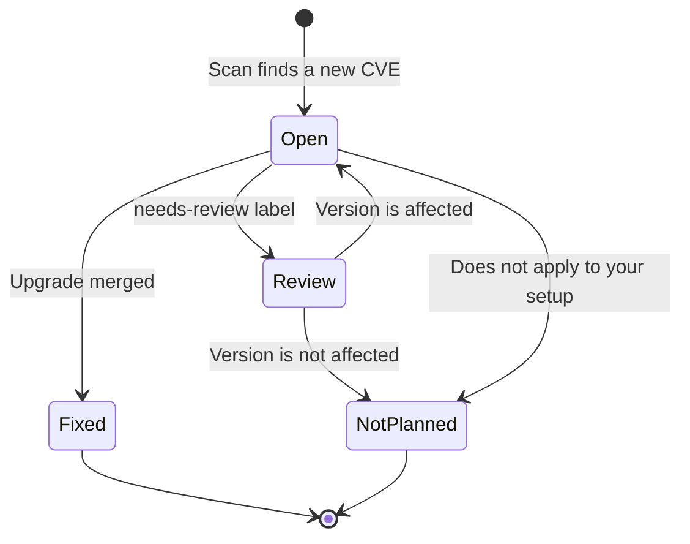

# Issue format

## Title

```text
[SEVERITY] [ENVIRONMENT/deployment] [score] CVE-id Tool - summary
```

| Part | Example | Values |
| --- | --- | --- |
| SEVERITY | `HIGH` | `CRITICAL`, `HIGH`, `MEDIUM`, `LOW`, `UNKNOWN` |
| ENVIRONMENT/deployment | `STAGE/stage-eu` | Uppercase environment, plus deployment ID when distinct; omitted for single-version records |
| score | `7.5` | CVSS base score from 0.0 to 10.0, or `n/a` |
| CVE id | `CVE-2026-115365` | The id from NVD |
| Tool | `OpenBao` | `display_name`, with environment/deployment scope when configured |
| summary | | Up to 120 characters from the CVE description |

[ADR 0023](../../adr/0023-prioritise-environment-in-finding-titles.md) records the current title
format. [ADR 0009](../../adr/0009-issue-title-and-labels.md) records the original label conventions.

```text
[HIGH] [STAGE] [7.1] CVE-2026-12345 OpenBao - short vulnerability summary
[HIGH] [STAGE/stage-eu] [7.1] CVE-2026-12345 OpenBao - short vulnerability summary
```

Severity and environment come first for compact lists. The CVE ID has no brackets. The product
name appears once, without a trailing environment suffix. Missing scores appear as `[n/a]`.
The summary is capped at 120 characters; output clients apply their title-length limits.

| Destination | Presentation |
| --- | --- |
| GitHub | Plain issue title, with separate severity and deployment labels |
| Jira Cloud | Plain ticket summary, with separate labels; Jira priority can be configured through additional create fields |
| Slack | Plain-text message block plus an escaped title in notification fallback text; Markdown is disabled for fallback text |

Square brackets are visual separators, not special markup or coloured badges. The same shared
title is used across destinations. Existing issues and tickets are not renamed by later scans.

## Description sections

| Section | Holds |
| --- | --- |
| Coloured box | Severity, score, tool, version, a link to the CVE and the fix date |
| What is the problem? | The full description from NVD |
| Details | Risk summary, affected tool, affected versions, severity, attack and impact, SSVC assessment, CVE record |
| How to fix it | Steps to upgrade, check the result and close the issue |
| Learn more | Links, with advisories first, and the CVSS vector |

## Severity

Severity comes from the CVSS score, using the same scale for every CVSS version.

| CVSS score | Severity | Result |
| --- | --- | --- |
| 0.0 | None | No issue |
| 0.1 to 3.9 | Low | `[LOW]` |
| 4.0 to 6.9 | Medium | `[MEDIUM]` |
| 7.0 to 8.9 | High | `[HIGH]` |
| 9.0 to 10.0 | Critical | `[CRITICAL]` |
| No score | Unknown | `[UNKNOWN]` |

## Fix deadlines

| Severity | Days to fix |
| --- | --- |
| Critical | 2 (the window is 24 to 48 hours) |
| High | 7 |
| Medium | 14 |
| Low | 21 |

Days count from the day the issue is opened. By default a CVE on the CISA KEV list gets 2 days, whatever
its score. Otherwise, a CVE with no score has no deadline.
The date is written once, and nothing tracks or enforces it after that. To change the days, use the global or per-tool
[configuration](configuration.md). The table above shows the built-in defaults.

## Risk summary

| Measure | Question | Used for | Source |
| --- | --- | --- | --- |
| CVSS | How severe is it? | Severity, title and fix deadline | NVD |
| EPSS | How likely is exploitation in the next 30 days? | Prioritising | FIRST |
| CISA KEV | Is it known to have been exploited in the wild? | Urgency, which overrides the severity deadline | CISA, then NVD as a backup |

`Could not check` means the source was down when the issue was written. It does not mean the CVE
is safe. A CVE on the KEV list always gets the red `CAUTION` box and the `known-exploited` label.

These results are written once and not updated later.

The box colour follows the severity: `CAUTION` for critical and high, `WARNING` for medium, `NOTE`
for low, and `IMPORTANT` when there is no severity. A second warning box appears when the result
needs a manual check.

## Labels

| Label | Meaning |
| --- | --- |
| `vuln-watch` | Opened by this tool |
| `severity-critical`, `severity-high`, `severity-medium`, `severity-low`, `severity-unknown` | The severity |
| `tool-openbao` | The inventory item. Each tool gets its own label |
| `needs-review` | NVD did not give enough version data to be sure |
| `known-exploited` | The CVE is on the CISA KEV list |

The score has no label, because it is in the title and the severity label already groups scores.

## Issue states



| State | How it looks on GitHub | Who changes it |
| --- | --- | --- |
| Open | Open issue | The scan opens it |
| Review | Open issue with `needs-review` | A person confirms the version |
| Fixed | Closed as completed | A person, or a pull request with `Closes #number` |
| NotPlanned | Closed as not planned, with a reason | A person |

The scan never closes or reopens an issue.

## Changes made to NVD text

- `@` mentions are broken so nobody gets notified.
- `<` is escaped.
- `github.com` links use `redirect.github.com`, which still works when clicked and adds no
  "mentioned this" note to other projects.

## Other destinations

Jira Cloud tickets use the same title and finding details, stored as plain text in an Atlassian
Document Format description. Required tracker labels and the finding identity marker are preserved.
Slack sends a plain-text title with an NVD link and URLs of tickets created in that attempt.
Disabled EPSS is shown as `Disabled`; a disabled KEV download is shown as `Catalog disabled`
unless the configured NVD fallback identifies known exploitation.
See [delivery setup](../how-to/configure-delivery.md).

## Deployment scope

For a deployment, the prefix includes `[PRODUCTION/prod-eu]` (or `[PRODUCTION]`
when environment and ID match, ignoring case). The details identify deployment, environment,
installed version, team and owner. Fix steps name the exact deployment version to update.
The identity marker is `tool/deployment-id/CVE`, and tickets receive a `deployment-ID` label.
Single-version records omit the environment prefix and retain their `tool/CVE` identity marker.
