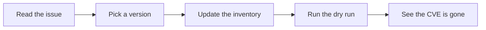

# Fix your first vulnerability

In this tutorial you practise the full fix on the demo inventory, from reading an issue to seeing
the CVE disappear from the scan. You change files on a practice branch and do not merge anything,
so the demo stays as it is. Do [Your first scan](first-scan.md) first.



## 1. Read the issue

Open [issue 4](https://github.com/iamunnip/infra-vuln-watch/issues/4), the critical one. Find these
parts:

- The **Fix by** date in the coloured box.
- The **Risk summary**, which shows CVSS, EPSS and CISA KEV side by side.
- **Affected versions**, which shows the range that includes your version.
- **How to fix it**, which names the version to upgrade to.

## 2. Make a practice branch

```bash
git switch -c practice-fix
```

## 3. Pick a version

The issue says version 2.6.0 or later fixes this CVE, but other issues name later versions. Choosing
the latest release fixes the most, so use `2.7.2`.

## 4. Update the inventory

In a real fix, you upgrade the tool first. Here it is a demo, so go straight to editing
`inventory/openbao.yaml`:

```yaml
version: "2.7.2"
```

## 5. Check the result

```bash
.venv/bin/python -m infra_vuln_watch --dry-run
```

You should see:

```text
Checking openbao 2.7.2
  Found 0 CVE(s) to report
```

The count can grow if new CVEs have been published since this was written. One version change has
cleared every CVE, which is why one pull request can close many issues.

## 6. Clean up

```bash
git restore inventory/openbao.yaml
git switch -
git branch -d practice-fix
```

## What would happen next in a real fix

You would open a pull request with one `Closes #number` line for each issue it fixes, then merge it.
See [Handle a vulnerability issue](../how-to/handle-an-issue.md).
