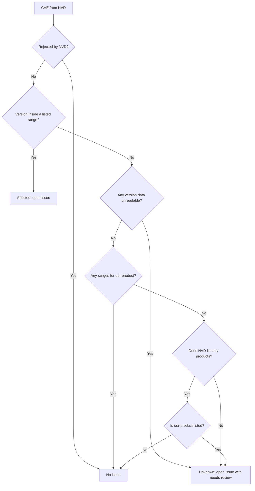

# How matching works

The hard part of this tool is not downloading CVEs. It is deciding which ones apply to the
version you run, because NVD data is often incomplete.

## Why two searches

NVD analysts add product data (called CPE data) to CVEs, but many recent CVEs are still waiting
or are deferred. Searching only by product misses them. Searching only by keyword misses CVEs
whose text never names the product. For OpenBao in November 2026, each search found CVEs the
other missed, so the tool runs both and merges the results.

## Why versions are compared locally

NVD can filter by exact version, but that returned nothing for a new release that was not yet
in its product dictionary, and it skips CVEs without analyst data. So the tool downloads every
CVE for the product and compares versions itself.

## Three possible answers

| Answer | When | Result |
| --- | --- | --- |
| Affected | The version is inside a listed range | Issue |
| Not affected | Ranges exist and the version is outside them, or the CVE is about another product | No issue |
| Unknown | The data is missing or cannot be read | Issue with `needs-review` |

Unknown opens an issue on purpose. A false alarm costs a minute of someone's time, while a
hidden vulnerability can cost far more.

## Limits

- The tool knows versions, not how you use the tool. An affected version may not be exploitable
  in your setup.
- A CVE that NVD has not published, or that names a different vendor or product than your
  inventory file, will not be matched.
- It does not check the libraries inside a tool.

See also [ADR 0002](../../adr/0002-search-nvd-twice-and-compare-versions-locally.md) and
[ADR 0003](../../adr/0003-report-unknown-results.md).
