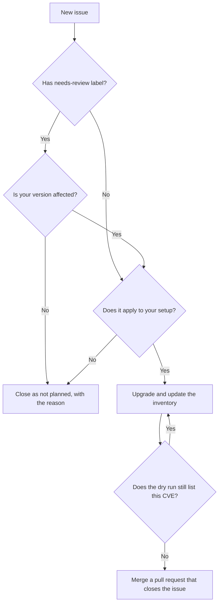

# Handle a vulnerability issue

[ADR 0013](../../adr/0013-how-a-vulnerability-gets-fixed.md) explains this process, with more
diagrams.

1. Check the **Fix by** date in the coloured box. A line saying **Known to be exploited in the wild**
   means attacks are already known, so handle that issue first. It always has a 2 day deadline.

2. Read **What is the problem?** and decide if the problem applies to how you use the tool.

3. If the issue has the `needs-review` label, NVD did not have enough version data, so confirm by
   hand that your version is affected.

4. Use the **Risk summary** to choose an order when you have several issues:

   | Order | Look for | Why |
   | --- | --- | --- |
   | First | CISA KEV says yes | Attacks are known to have happened |
   | Next | High CVSS with a high EPSS | Severe and likely to be attacked |
   | Then | The remaining issues, by Fix by date | Severe but less likely, or less severe |

   `Could not check` means the source was down when the issue was written, so look the CVE up by
   hand before you rely on it.

5. Pick one:

   | Decision | What to do |
   | --- | --- |
   | Fix it | Follow **How to fix it**, then merge a pull request with a `Closes #number` line for each issue it fixes |
   | Does not apply | Close the issue as "not planned", with the reason in a comment |

The tool never reopens a closed issue and never opens a second one for the same tool and CVE,
even if the score changes later.

Keep the `vuln-watch` label and the hidden `vuln-watch-id` line in the description. The tool
uses both to know the CVE is already reported.
