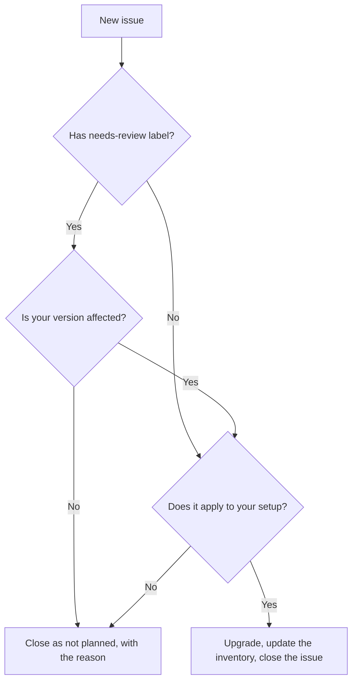

# Handle a vulnerability issue

1. Read the **Description** and decide if the problem applies to how you use the tool.

2. Check the `needs-review` label. It means NVD did not have enough version data, so you need
   to confirm by hand that your version is affected.

3. Pick one:

   | Decision | What to do |
   | --- | --- |
   | Fix it | Upgrade the tool, update `version` in the inventory file, close the issue |
   | Does not apply | Close the issue as "not planned", with the reason in a comment |

The tool never reopens a closed issue and never opens a second one for the same tool and CVE,
even if the score changes later.

Keep the `vuln-watch` label and the hidden `vuln-watch-id` line in the description. The tool
uses both to know the CVE is already reported.
