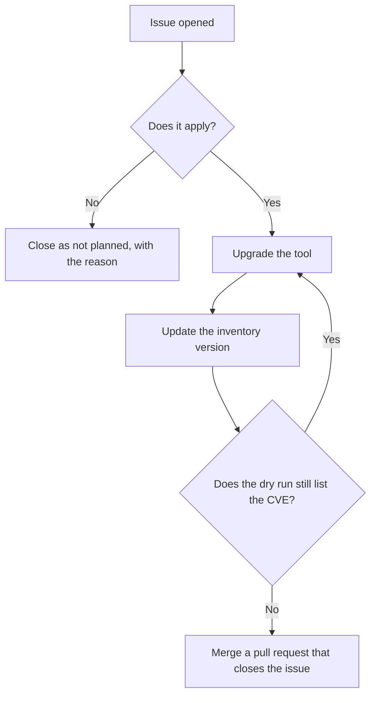

# Process

# Order of work

1. Listed on CISA KEV. See [CVSS, EPSS and KEV](../vulnerability-data/cvss-epss-kev.md).
2. High CVSS with a high EPSS.
3. The rest, by fix date. See [Fix windows](fix-windows.md).

# Rules

- The team and owner named in the issue are responsible for the fix.
- People upgrade tools and close issues. The scanner does neither. It only flags an open issue with
  a comment and labels, such as `no-longer-affected`, which asks a person to check and close it.
- A closed issue is final, and the scanner never reopens it. Reopen it by hand after a mistake.
- One upgrade can fix many CVEs for an installation, so one pull request can close many issues.
- For multi-deployment inventory, upgrade and verify the specific deployment named in the
  finding. Update its version entry, not another environment's version. Closing a production
  finding requires evidence that production was fixed, even if staging was already upgraded.
