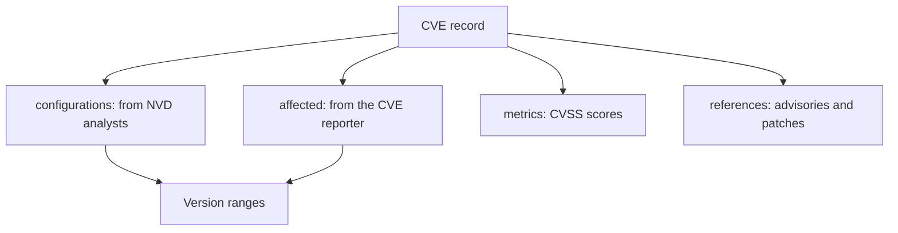

# Schema

Version data can be in two places, and either can be missing.

## configurations

Written by NVD analysts. Absent while `vulnStatus` is `Awaiting Analysis` or `Deferred`.

```json
{"vulnerable": true, "criteria": "cpe:2.3:a:openbao:openbao:*:*:*:*:*:*:*:*", "versionEndExcluding": "2.5.2"}
```

## affected

Written by the CVE reporter. Formats vary by reporter:

```json
{"version": "< 2.3.0", "status": "affected"}
{"version": ">= 0.1.0, < 2.3.2", "status": "affected"}
{"version": "2.2.0", "lessThan": "2.6.4", "versionType": "semver", "status": "affected"}
{"version": "2.6.4", "versionType": "semver", "status": "unaffected"}
```

A start of `0` or `unspecified` with a `lessThan` means "from the first version". Without a
`lessThan`, those words give no usable version.

One product can have several `affected` ranges, one for each release branch. Version 2.7.0 can
be affected even though 2.6.4 is fixed.

## metrics

Beside the CVSS scores, `metrics.ssvcV203` can hold an SSVC assessment with `exploitation`,
`automatable` and `technicalImpact`. CVSS 4.0 names its impacts `vulnConfidentialityImpact`, while
CVSS 3 uses `confidentialityImpact`. A CVE on the CISA known exploited list has `cisaExploitAdd`
at the top level of the record.

# Diagram



# Notes

- A keyword search can return CVEs for other products, such as `openbao-plugins` or a Red Hat
  product listed as unaffected. Always compare vendor and product.
- Reporter names are free text and can differ from CPE names, such as
  `Apache Software Foundation` for the CPE vendor `apache`, or a Go module path as the product. A
  name mismatch in reporter data alone does not show that a CVE is about another product.
- An `unaffected` entry can sit inside a broader `affected` range, as when a release branch has a
  backported fix. `lessThanOrEqual` can use a wildcard such as `2.5.*` for the rest of a branch.
- A CVSS v2 record keeps `baseSeverity` beside `cvssData`, while newer versions keep it inside.

## Incomplete version data

Malformed CPE criteria produce an unknown result for human review. When any matching range
has no upper bound, the scanner cannot establish a fixed version from those ranges and omits
numeric fix guidance, even if another matching range has an upper bound. Check vendor
advisories before choosing an upgrade.
